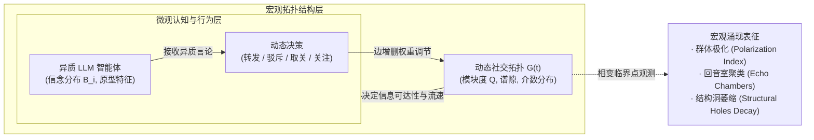

# Network Evolve Lab (`NetworkEvolveLab`)

> **大模型认知与复杂网络拓扑的自组织双向共演实验室（Co-evolution of Cognition & Topology）**  
> 从"在既定静态网络上推演传播"升级为"语义认知驱动社交关系演化，网络结构反向塑造群体认知"，探索信息茧房（Echo Chamber）、群体极化（Polarization）与拓扑相变（Phase Transition）的微观发生机制。

---

## 一句话定位

不同于以往社会仿真将网络结构作为"外生静态输入"，本项目探索**大模型智能体的真实语义交互如何动态重塑社交网络拓扑（Follow / Unfollow / Mute / Block），以及新网络拓扑如何反向约束信息扩散的宏观涌现闭环**。



---

## 继承自 `WorldSimulationLab` 的核心范式与进化

1. **延续异质原型划分（Archetypes）**：
   - 不采用同质化 Agent，继承在 Higgs 数据上验证过的三类行为模式：`hub_broadcaster`（高声量议程设置者）、`active_bridger`（跨群体转发桥梁）、`long_tail_responder`（长尾受众）。
2. **算力帕累托控制（$K=3$ 原则）**：
   - 杜绝无节制的大规模多 Agent 随意跑；核心群落保持精简，外围采用"微观统计锚 + 语义代理"，单轮实验控制在百次 API / 几分钟内收敛。
3. **因果在线反馈与阻尼（Causal Feedback Damping）**：
   - 智能体信念更新采用有阻尼的连续空间更新，避免单次极端 Prompt 引发的策略跑飞。

---

## 核心科学问题（Research Questions）

- **RQ1（微观真实性）**：引入大模型语义理解的关系断连行为（Unfollow），与传统的阈值距离模型（如 Hegselmann-Krause / DeGroot 标量模型）相比，是否会涌现出更符合现实人类社群的长尾聚类与非对称撕裂？**以及，非对称撕裂究竟由哪个机制产生？**
- **RQ2（相变临界点）**：在何种推荐算法摩擦力（Recommendation Friction）或观点激进化程度下，全局连通图会发生**拓扑断裂相变（Topological Phase Transition）**，迅速瓦解为互不连通的独立子群？
- **RQ3（反事实桥接干预）**：在极化初期，针对 Top 2% 的 `active_bridger`（跨界桥接节点）进行曝光扶持或跨群分发，能否以极小的拓扑扰动代价（$< 5\%$ 边变动）阻止全局回音室的形成？

---

## 预先设定假说与判定指标（Pre-specified Criteria）

| 假说 | 验证内容 | 判定标准 | 结论 |
| :--- | :--- | :--- | :--- |
| **H1 (语义极化相变)** | 开放取关与拉黑机制后，网络模块度（Modularity $Q$）随演化时间单调上升。 | 在 $T=20$ 轮交互内，网络模块度 $Q$ 从初期的 $<0.25$ 跃升至 $>0.65$，形成至少 2 个同质信念回音室。 | **证伪 (Falsified)** —— 在 12 组参数配置、通过率 0% 下，$Q$ 收敛于 $[0.174, 0.487]$（最高 0.500）。**证伪依据是可核验的经验事实**：演化的 Louvain 划分在 70–90% 的运行中为双极（$K=2$）、最多三裂（$K\le 3$），且社群度体积严重不均衡，使实际可达的 $Q$ 始终 $\le 0.500$（推广上界为 $Q\le 1-1/K$，$Q>0.65$ 需 $K\ge3$）。Phase 5 对基准矩阵全部 42 个单元与 12 组演化网格逐一核验该不等式，**零违反**。 |
| **H2 (桥接层脆弱性)** | 跨群桥接节点承受双向认知失调压力，其关系断裂速率显著高于群内节点。 | Bridger 节点的平均连边留存率比社群内部节点低 $40\%$ 以上（$p < 0.01$）。 | **证伪 (Falsified)** —— Bridger 留存率 0.664 vs 其余节点 0.511（种子级差距 −0.299，95% CI [−0.359, −0.238]，$p = 1.000$），Bridger 显著**更**抗断裂。 |
| **H3 (反事实去极化干预)** | 施加去中心化多样性推荐策略，能够延缓极化进程并保留跨群传播通道。 | 跨群有效信息传播到达率提升 $\ge 35\%$，同时 $Q$ 值下降 $\ge 0.20$。 | **不成立 (Not supported)** —— 前件不满足：多样化推荐 $\rho_{\mathrm{div}}=0.15$ 的跨群到达率相对增益为 −12.3%（$p = 0.72$，不显著）；后件亦不满足：$\Delta Q = -0.038$（$p = 7.4\times10^{-8}$），远未达到 $-0.20$。组合治理下到达率增益 +19.4%（$p = 0.040$）仍低于 $+35\%$。 |

> 上表中的数值由 `scripts/generate_paper_tables.py` 从冻结结果自动生成，CI 会在漂移时失败。

---

## 快速开始

```bash
# 1. 环境准备
uv venv --python 3.11 .venv
source .venv/bin/activate
uv pip install -r requirements.txt
pip install -e .

# 2. 运行完整单元测试套件（18 项，含 9 项研究不变量回归测试）
python -m unittest discover -s tests -v
# 或
python reproduce.py --test

# 3. 复现各阶段科学实验
# Phase 0: 动力学基线与相变临界容忍度扫描
python -m src.network_evolve.phase0 --nodes 100 --rounds 20 --seeds 5 --out results/phase0_sweep.json

# Phase 1b: 异质原型 Bridger 受压消融 (H2) 与 超长演化 H1 判定网格
python -m src.network_evolve.phase1b --seeds 20 --rounds 60 --out results/phase1b.json
# Phase 1b-structural: H2 结构位置对照（Hub=度最高，Bridger=betweenness 最高）
python -m src.network_evolve.phase1b_structural --seeds 20 --rounds 60 --out results/phase1b_structural.json

# Phase 1c (新增): 跨拓扑相变临界点测量（细网格 θ + 三个可操作判据）
python -m src.network_evolve.phase1c_threshold --seeds 10 --rounds 40 --nodes 100 --out results/phase1c_threshold.json
# Phase 1c-matched: 度数/互惠率匹配后的 robustness 重跑
python -m src.network_evolve.phase1c_threshold --seeds 10 --rounds 40 --nodes 100 \
    --theta-min 0.15 --theta-max 0.85 --matched-degree 6.6 --matched-reciprocity 0.65 \
    --out results/phase1c_matched.json

# Phase 2: 多维语义信念对照 (DeGroot vs HK vs Proxy vs 真实 LLM)
python -m src.network_evolve.phase2_offline --seeds 20 --out results/phase2_offline.json
python -m src.network_evolve.phase2_llm replay --seeds 0,1,2 --n 40   # 事件级对齐重放（无需 API）

# Phase 3: 反事实去极化政策干预 (多样化推荐、Bridger 扶持、Hub 限流与组合治理)
python -m src.network_evolve.phase3 --seeds 20 --rounds 60 --out results/phase3.json

# Phase 4 (新增): 非对称撕裂的机制归因消融（同步/异步 × 标量/多维 × 各向异性）
python -m src.network_evolve.phase4_attribution --seeds 20 --rounds 30 --nodes 60 --out results/phase4_attribution.json

# Phase 5 (新增): 模块度 K 社群推广上界的一致性审计
python -m src.network_evolve.phase5_bound_audit --seeds 10 --rounds 60 --out results/phase5_bound_audit.json

# Phase 8 (新增): 公开真实立场图 PolBlogs 外部效度检查
python scripts/build_polblogs_caches.py --nodes 100 --seeds 0-9
python -m src.network_evolve.phase8_real_stance --seeds 10 --rounds 25 --nodes 100 \
    --out results/phase8_real_stance.json

# Phase 6 (新增): 真实 LLM 认知层挂进旗舰引擎 vs 规则后端（同 seed 配对对照）
#   输出同时包含 placebo 臂（等量随机 unfollow）与逐事件 LLM-vs-规则一致率；
#   需要 LLM 凭据：NETWORK_EVOLVE_LLM_BASE_URL / NETWORK_EVOLVE_LLM_API_KEY
python -m src.network_evolve.phase6_llm_engine --seeds 10 --rounds 30 --nodes 60 \
    --llm-events 6 --budget-calls 400 --out results/phase6_llm_engine.json

# Phase 7 (新增): 网络规模敏感性 N ∈ {60,100,250,500,1000} + 真实 Higgs N=1000 子图
python -m src.network_evolve.phase7_scaling --sizes 60,100,250,500,1000 \
    --seeds 10 --rounds 60 --real-higgs --out results/phase7_scaling.json

# SOTA Benchmark: 6 数据集（5 代理 + 1 真实）× 7 方法的横向评测
python -m src.network_evolve.benchmark_suite --nodes 60 --rounds 25 --seeds 10 --out results/sota_benchmark.json

# 4. 生成出版级全彩学术论文图表 (Figure 1 ~ Figure 7, PNG + SVG) 与自动生成论文表格
python scripts/generate_figures.py
python scripts/generate_paper_tables.py

# 5. 记录实验溯源清单（命令 / SHA256 / Git 提交 / 环境）
python scripts/record_provenance.py

# 6. 构建 ICWSM/AAAI 单文件投稿包并编译论文 PDF（需要 tectonic）
python scripts/build_submission.py
tectonic -X compile build/icwsm/NetworkEvolveLab_ICWSM.tex --outdir build/icwsm

# 一键复现全链路（测试 → 全部实验 → 基准 → 图表 → 表格 → 溯源 → 投稿包 + PDF）
python reproduce.py --all
```

---

## 基准数据集与对比方法（务必区分「代理网络」与「真实公开数据」）

### 6 个基准数据集（`src/network_evolve/datasets.py` + `src/network_evolve/datasets_real.py`）

**代理网络（按公开统计量校准的合成结构，作为受控初始条件）**

1. `DEBATE Benchmark (NeurIPS 2024)`：多轮争议性人类信念先验（$\mu, \sigma$）。
2. `SNAP Higgs Twitter Dataset`：幂律度分布与高介数跨界节点结构**代理**。
3. `Twitter 2020 US Election`：双极政治回音室与 DW-NOMINATE 意识形态空间**代理**。
4. `Reddit Political Discourse (ConvoKit)`：4 大版块多议题交叉回复树**代理**。
5. `Birdwatch / Community Notes`：开源跨意识形态桥接共识评测**代理**。

**真实公开数据**

6. `SNAP_Higgs_Real`：由 SNAP 官方 `higgs-social_network.edgelist.gz`（**456,626 节点 / 14,855,842 条有向边**，SHA256 记录于 `data/raw/README.md`）派生的诱导子图。
   - 节点池 = 按总度取前 $4N$ 名后由种子随机抽样 ⇒ 不同种子得到不同但统计同阶的幂律子图。
   - ⚠️ **原始文件不含任何意识形态标注**，其"阵营"由真实拓扑的 Louvain 社区派生，属**结构代理变量**，不可表述为真实政治立场。
   - 重建缓存（需要本地原始文件）：`python scripts/build_real_higgs_caches.py --nodes 60 --seeds 0-9`

### 7 个对比方法（`src/network_evolve/baselines.py` + 主引擎）

1. `DeGroot (1974)`（经典线性加权共识）
2. `Hegselmann-Krause (2002)`（标量刚性有界信任断裂）
3. `Friedkin-Johnsen (1990)`（顽固先验信念锚定）
4. `Generative Agents (Park et al., 2023)`（记忆反思，静态拓扑）
5. `Prompt-Rewire (Gu et al., 2025)`（自然语言无阻尼重连）
6. `Ours (simplified re-impl.)`（同一思想的简化重实现，作为消融参照）
7. `Ours (CoEvolution Engine)` —— **旗舰主引擎亲自参赛**（`CoEvolutionEngine`，支持注入外部数据集拓扑与信念先验）

---

## 核心发现速览

- **H1 证伪，但证伪理由被严格化**：模块度推广上界为 $Q \le 1-1/K$（$K$ = 实现划分的社群数），$K=2$ 时为 0.500；$Q>0.65$ 需 $K\ge 3$。本引擎的划分在 70–90% 的运行中为双极、最多三裂，但社群度体积不均衡使可达 $Q$ 始终 $\le 0.500$，故 H1 被经验证伪。Phase 5 对基准矩阵 42 个单元与 12 组演化网格逐一核验该不等式，**零违反**。
- **RQ2 的相变阈值被重新测量，原「跨拓扑一致」断言被证伪**（Phase 1c 临界点测量）：此前用于支撑该断言的 $\theta$ 采样网格在待检验区间 $[0.50,0.55]$ 内只有一个点，原理上无法判定。改用步长 0.05 的扩展细网格（$\theta\in[0.15,0.85]$，4 拓扑 × 10 种子）与三个可操作判据重测：连通性恢复、模块度塌缩、极化塌缩三个判据分别只有 **1/40、2/40、3/40** 的种子级估计落在该区间内。连通性恢复阈值 $\theta^*_{\mathrm{frag}}$ 的估计为 ER 0.334、BA 0.400、WS 0.357、实证双极 0.520，扩展网格下最小值 0.249，**左删失已完全消除（0/40）**；但该阈值与初始平均度、互惠率混淆，**不能单独归因于宏观拓扑**。把四个拓扑都匹配到初始平均出度 6.60、互惠率 0.648 后重跑，$\theta^*_{\mathrm{frag}}$ 的拓扑间极差从 **0.186 降到 0.088**，ER/WS/BA 排序不再稳定，进一步说明残余差异不是稳健的拓扑效应。模块度塌缩判据在小世界与实证双极网络上 **10/10 种子右删失**，这类删失被显式报告而非隐藏。
- **H2 证伪**：Bridger 留存率显著高于外围节点，但该优势来自**容忍度禀赋**而非结构洞位置；等容忍度时差距消失（gap $-0.034$，95% CI 跨 0）。按 betweenness 选择结构位置 Bridger 的对照臂给出同样的判定（base gap $-0.277$；等容忍度 gap $+0.019$，95% CI 跨 0），H2 仍被证伪。判定统计量以**种子**为独立单元（避免节点级伪重复）。
- **RQ1 归因被分离并收窄**（Phase 4 十臂受控消融）：同步调度下，标量模型与各向同性多维模型的断裂**严格对称**（$A_{\mathrm{rupture}} \equiv 0$，20/20 种子）；只有引入**个体各向异性语义判据**后才出现单向断裂（$A_{\mathrm{rupture}}=0.216$，20/20 种子，Wilcoxon $p=1.9\times10^{-6}$）；**纯时序异步**在纯标量模型、均匀发言概率下即可制造非对称断裂（$A_{\mathrm{rupture}}=0.053$，$\Delta A=+0.053$，$p=6.5\times10^{-4}$），而发言频率偏置无显著效应（$\Delta A=+0.006$，$p=0.711$）。各向异性下的调度效应为 $+0.002$（$p=0.648$），但其与各向同性下的调度效应之差（交互项）为 $-0.039$（95% CI $[-0.088,+0.010]$，$p=0.143$），因此只能表述为**描述性次可加、交互项不显著**，不能声称已证明饱和。
- **Phase 6 阴性结论加强**：新增“等量随机 unfollow”安慰剂臂（每 seed 平均 2.9 条随机断边）与逐事件规则反事实一致率。安慰剂臂的模块度差为 $+0.002$（$p=0.572$）；LLM 与规则臂的 Q 差为 $-0.004$（$p=0.418$），LLM 与安慰剂臂差为 $-0.006$（$p=0.193$）。逐事件一致率为 **96.3%（1657/1721）**，说明 LLM 的动作策略接近但不完全等同于规则后端，“结构 regime 不变”不是随机断边数量造成的假象。
- **H3 不成立**：多样化推荐确有单调剂量响应地压低模块度（$\Delta Q=-0.038$，$p=7.4\times10^{-8}$）并提升跨阵营连边（$0.020\to0.043$，组合治理 $0.020\to0.062$），但到达率增益与模块度降幅**均未达到预设定阈值**，显示"同质性惯性"。

---

## 目录索引

- [paper/main.tex](paper/main.tex) & [paper/appendix.tex](paper/appendix.tex)：**完整学术论文手稿与补充材料（LaTeX）**
- [paper/tables/](paper/tables/)：**由结果 JSON 自动生成的论文表格与数值宏**（`scripts/generate_paper_tables.py`）
- [docs/archive/ARS_FULL_CHAIN_AUDIT.md](docs/archive/ARS_FULL_CHAIN_AUDIT.md)：历史复核记录（已归档；当前数字以 paper/tables/macros.tex 与 results/ 为准）
- [docs/archive/EXPERIMENT_REPORT.md](docs/archive/EXPERIMENT_REPORT.md)：历史实验报告（已归档）
- [docs/ARCHITECTURE.md](docs/ARCHITECTURE.md)：动力学状态转移方程与数学形式化
- [src/network_evolve/](src/network_evolve/)：动态加权图、数据集加载器、基线方法与政策干预引擎源码
- [results/figures/](results/figures/)：出版级矢量与位图图表（Figure 1 至 Figure 7）
- [results/](results/)：冻结的实验数据（JSON 与日志）+ [results/PROVENANCE.json](results/PROVENANCE.json) 溯源清单
- [data/raw/README.md](data/raw/README.md)：真实公开数据来源、SHA256 与派生配方
