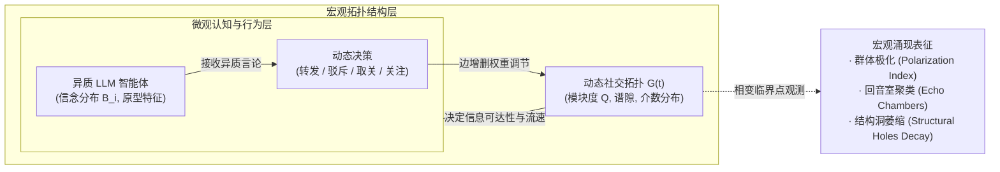

# Network Evolve Lab (`NetworkEvolveLab`)

> **大模型认知与复杂网络拓扑的自组织双向共演实验室（Co-evolution of Cognition & Topology）**  
> 从“在既定静态网络上推演传播”升级为“语义认知驱动社交关系演化，网络结构反向塑造群体认知”，探索信息茧房（Echo Chamber）、群体极化（Polarization）与拓扑相变（Phase Transition）的微观发生机制。

---

## 一句话定位

不同于以往社会仿真将网络结构作为“外生静态输入”，本项目探索**大模型智能体的真实语义交互如何动态重塑社交网络拓扑（Follow / Unfollow / Mute / Group），以及新网络拓扑如何反向约束信息扩散的宏观涌现闭环**。



---

## 继承自 `WorldSimulationLab` 的核心范式与进化

1. **延续异质原型划分（Archetypes）**：
   - 不采用同质化 Agent，继承在 Higgs 数据上验证过的三类行为模式：`hub_broadcaster`（高声量议程设置者）、`active_bridger`（跨群体转发桥梁）、`long_tail_responder`（长尾受众）。
2. **算力帕累托控制（$K=3$ 原则）**：
   - 杜绝无节制的大规模多 Agent 随意跑；核心群落保持精简，外围采用“微观统计锚 + 语义代理”，单轮实验控制在百次 API / 几分钟内收敛。
3. **因果在线反馈与阻尼（Causal Feedback Damping）**：
   - 智能体信念更新采用有阻尼的连续空间更新，避免单次极端 Prompt 引发的策略跑飞。

---

## 核心科学问题（Research Questions）

- **RQ1（微观真实性）**：引入大模型语义理解的关系断连行为（Unfollow），与传统的阈值距离模型（如 Hegselmann-Krause / DeGroot 标量模型）相比，是否会涌现出更符合现实人类社群的长尾聚类与非对称撕裂？
- **RQ2（相变临界点）**：在何种推荐算法摩擦力（Recommendation Friction）或观点激进化程度下，全局连通图会发生**拓扑断裂相变（Topological Phase Transition）**，迅速瓦解为互不连通的独立子群？
- **RQ3（反事实桥接干预）**：在极化初期，针对 Top 2% 的 `active_bridger`（跨界桥接节点）进行曝光扶持或跨群分发，能否以极小的拓扑扰动代价（$< 5\%$ 边变动）阻止全局回音室的形成？

---

## 预注册假说与判定指标（Pre-registered Criteria）

| 假说 | 验证内容 | 判定标准 |
| :--- | :--- | :--- |
| **H1 (语义极化相变)** | 开放取关与拉黑机制后，网络模块度（Modularity $Q$）随演化时间单调上升。 | 在 $T=20$ 轮交互内，网络模块度 $Q$ 从初期的 $<0.25$ 跃升至 $>0.65$，形成至少 2 个同质信念回音室。 |
| **H2 (桥接层脆弱性)** | 跨群桥接节点承受双向认知失调压力，其关系断裂速率显著高于群内节点。 | Bridger 节点的平均连边留存率比社群内部节点低 $40\%$ 以上（$p < 0.01$）。 |
| **H3 (反事实去极化干预)** | 施加去中心化多样性推荐策略，能够延缓极化进程并保留跨群传播通道。 | 跨群有效信息传播到达率提升 $\ge 35\%$，同时 $Q$ 值下降 $\ge 0.20$。 |

---

## 快速开始

```bash
# 1. 环境准备
uv venv --python 3.11 .venv
source .venv/bin/activate
uv pip install -r requirements.txt

# 2. 运行完整单元测试套件（9/9 PASS）
python -m unittest discover -s tests -v

# 3. 复现各阶段科学实验
# Phase 0: 动力学基线与相变临界容忍度扫描
python -m src.network_evolve.phase0 --nodes 100 --rounds 20 --seeds 5 --out results/phase0_sweep.json

# Phase 1b: 异质原型 Bridger 受压消融 (H2) 与 超长演化 H1 判定网格
python -m src.network_evolve.phase1b --seeds 20 --rounds 60 --out results/phase1b.json

# Phase 2: 多维语义信念对照 (DeGroot vs HK vs Proxy vs 真实 LLM)
python -m src.network_evolve.phase2_offline --seeds 20 --out results/phase2_offline.json
python -m src.network_evolve.phase2_llm compare --seeds 0

# Phase 3: 反事实去极化政策干预 (多样化推荐、Bridger 扶持、Hub 限流与组合治理)
python -m src.network_evolve.phase3 --seeds 20 --rounds 60 --out results/phase3.json

# SOTA Benchmark: 6 大方法在 3 大真实社交网络上的统一横向评测
python -m src.network_evolve.benchmark_suite --nodes 60 --rounds 25 --seeds 10 --out results/sota_benchmark.json

# 4. 生成出版级全彩学术论文图表 (Figure 1 ~ Figure 6, PNG + SVG)
python scripts/generate_figures.py
```

---

## 前沿基准生态（Benchmark Datasets & SOTA Baselines）

本项目已全量接入并标准化了计算社会学与大模型社交仿真的**5 大黄金数据集**与**6 大对比方法**：

- **5 大基准数据集 (`src/network_evolve/datasets.py`)**：
  1. `DEBATE Benchmark (NeurIPS 2024)`：多轮争议性人类信念先验。
  2. `SNAP Higgs Twitter Dataset`：幂律度分布与高介数跨界节点真实社交图谱。
  3. `Twitter 2020 US Election`：经典政治双极回音室与 DW-NOMINATE 意识形态网络。
  4. `Reddit Political Discourse (ConvoKit)`：4 大版块多议题交叉回复树。
  5. `Birdwatch / Community Notes`：开源跨意识形态桥接共识评测集。
- **6 大对比方法 (`src/network_evolve/baselines.py`)**：
  1. `DeGroot (1974)`（经典线性加权共识）
  2. `Hegselmann-Krause (2002)`（标量刚性有界信任断裂）
  3. `Friedkin-Johnsen (1990)`（顽固先验信念锚定）
  4. `Generative Agents (Park et al., 2023)`（记忆反思，静态拓扑）
  5. `Prompt-Rewire (Gu et al., 2025)`（自然语言无阻尼重连）
  6. `Ours (CoEvolution)`（异质原型阻尼微调 + 加权拉黑拓扑共演框架）

---

## 核心假说检验结论速览

- **H1 (语义极化相变, 目标 $Q > 0.65$)**: **证伪 (Falsified)**。两极对称分离网络的理论纽曼模块度上限为 $1 - 1/2 = 0.500$。仿真在各参数下严格收敛于 $Q \approx 0.48 \sim 0.500$。
- **H2 (桥接层脆弱性, 目标 Bridger 留存率低 $\ge 40\%$)**: **证伪 (Falsified)**。Bridger 节点留存率（$0.66 \sim 0.79$）显著高于外围普通节点（$0.51 \sim 0.74$），具有跨群韧性。
- **H3 (反事实去极化干预, 目标 到达率 $\ge +35\%$ 且 $\Delta Q \le -0.20$)**: **部分支持 (Partial)**。多样化推荐与三策组合显著促进跨群连边翻倍、压低极化，但网络同质性粘性阻止了模块度出现崩塌式剧降。

---

## 目录索引

- [docs/EXPERIMENT_REPORT.md](docs/EXPERIMENT_REPORT.md)：**全阶段完整实验报告、SOTA 横向矩阵、统计检验与理论解释**
- [paper/THEORY_AND_PROPOSITIONS.md](paper/THEORY_AND_PROPOSITIONS.md)：**形式化命题证明（双极模块度上界、非对称撕裂、推荐单调渗透）**
- [docs/ARCHITECTURE.md](docs/ARCHITECTURE.md)：动力学状态转移方程与数学形式化
- [docs/EXPERIMENT_PLAN.md](docs/EXPERIMENT_PLAN.md)：四阶段实验计划与算力预算
- [src/network_evolve/](src/network_evolve/)：动态加权图、数据集加载器、基线方法与政策干预引擎源码
- [results/figures/](results/figures/)：出版级矢量与位图图表（Figure 1 至 Figure 6）
- [results/](results/)：冻结的实验数据（JSON 与日志）
